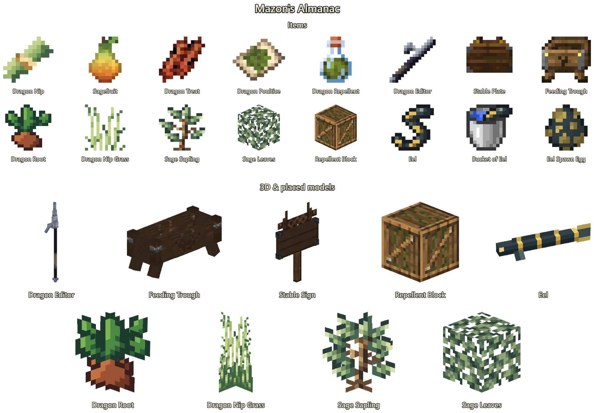
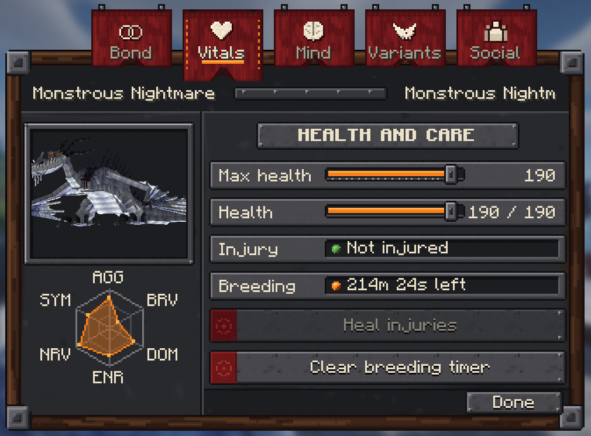
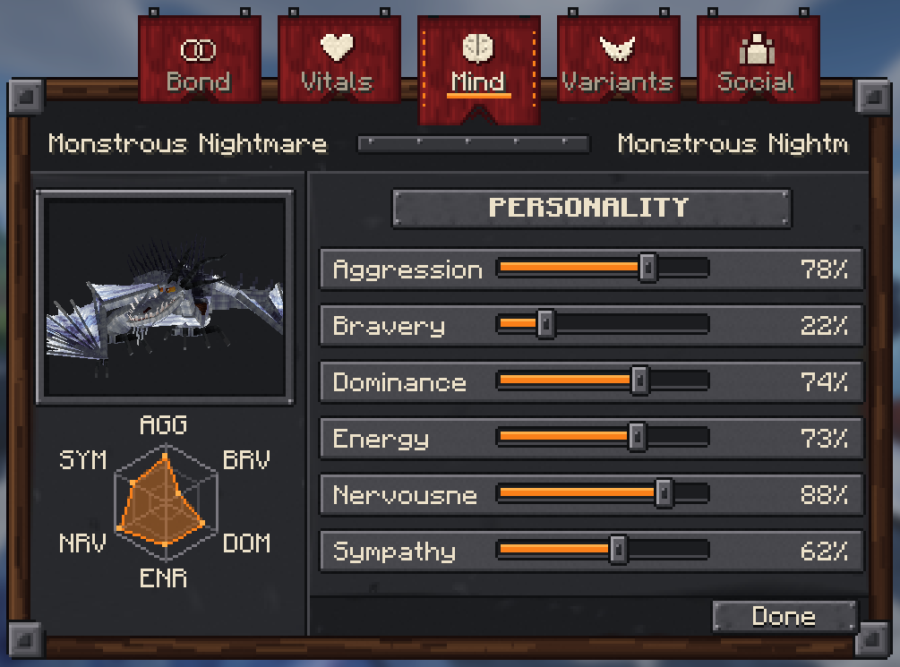

<p align="center">
  
</p>

<p align="center"><b>Raise your dragons like a real Viking: earn their trust, heal their wounds, and shape them your way.</b></p>

<p align="center">
  
  
  
  
</p>

Mazon's Almanac is an addon for [Book of Dragons](https://www.curseforge.com/minecraft/mc-mods/book-of-dragons). It adds the gear a dragon rider would actually carry: ways to win over wild dragons, treat injured ones, run a stable, and tweak every dragon to your liking.

## Quick start

1. Install NeoForge 21.1 for Minecraft 1.21.1 and Java 21.
2. Drop Book of Dragons, Fauna Engine, and this mod into your `mods` folder.
3. Start the game and look for the **Mazon's Almanac** tab in the creative inventory.

## What's in the Almanac



| | Item | What it does |
|---|---|---|
|  | **Dragon Nip** | Calms a wild dragon for five minutes so it's easier to tame. Grow more with Dragon Nip Grass. |
|  | **Sagefruit** | Makes a dragon befriend every dragon within 32 blocks. Grows on sage trees. |
|  | **Dragon Treat** | Builds loyalty with a dragon you've already tamed. |
|  | **Dragon Poultice** | Shortens an injured dragon's recovery time. |
|  | **Feeding Trough** | Hungry dragons nearby walk over and eat on their own. |
|  | **Stable Plate and Sign** | Link a plate to a Dragon Roost and name your stable. Tamed dragons near the roost stay put. |
|  | **Dragon Repellent** | Drink it for 8 minutes of Dragon Scent and wild dragons keep their distance. Also a placeable block. |
|  | **Eel** | A new catch when you fish in rivers and swamps. |
|  | **Dragon Editor** | Creative only. Opens the editor below. |
| | **Hiccup's Sketchbook** | Edit the colors and markings of a dragon you've tamed. |

Dragon Root is a block that drives off wild dragons within 6 blocks when you place it.

<details>
<summary><b>How to get everything</b></summary>

### Crafting

| Item | Recipe |
|---|---|
| Dragon Treat (makes 2) | Cooked cod or cooked salmon, wheat, honey bottle (shapeless) |
| Dragon Poultice | Paper, moss block, honey bottle (shapeless) |
| Feeding Trough | Wooden slabs across the top and middle, sticks for the legs (`S S` / `SSS` / `L L`) |
| Stable Plate | Three iron ingots on top, then iron, leather, iron below |
| Dragon Repellent | Eel, Dragon Root, glass bottle (shapeless) |
| Dragon Repellent Block | Two Dragon Repellent and two moss blocks (shapeless) |
| Dragon Editor | Creative inventory only |
| Hiccup's Sketchbook | Creative inventory or `/give @s bodaddon:hiccups_sketchbook`. Survival recipe pending. |

### Finding and gathering

| What | Where | How to get it |
|---|---|---|
| Dragon Nip | Dragon Nip Grass in plains, sunflower plains, meadows, forests, taigas, and windswept hills and forests. About 1 in 40 chunks has a patch. | Break the grass with a **sword** for 1 to 2 Dragon Nip. Other tools drop nothing. Shears give you the grass itself to replant. |
| Dragon Root | Swamps, mangrove swamps, dark forests, and old growth pine and spruce taigas. About 1 in 40 chunks has a small patch. | Break it with anything. |
| Sage trees | Forests, flower forests, birch forests, old growth birch forests, and dark forests. Rare: about 1 in 300 chunks. | Break the leaves for Sagefruit and saplings. A hoe is the fastest tool. |
| Sagefruit | Fruiting sage leaves. | Break them without shears or Silk Touch. Those give you the leaf block instead. |
| Sage Sapling | Sage leaves. | A 5% drop per leaf, up to 10% with Fortune III. |
| Eel | Rivers, swamps, and mangrove swamps. | About 1 in 8 fish you catch there is an eel. Wild eels also spawn in those biomes, but rarely. |

### Setting things up

- **Feeding Trough:** place it and dragons within 16 blocks come to eat. You can change the range in the config.
- **Stable Plate:** right-click a Dragon Roost with it to link them, then place it like a sign within 24 blocks of the roost. Tamed dragons in that area keep their stay order. You can change the range in the config.
- **Dragon Treat and Dragon Poultice:** use them on your own tamed dragon. The poultice takes 60 seconds to work and then cuts an hour off the injury.
- **Dragon Nip and Sagefruit:** feed them to a wild dragon or one of your own. Nip calms it for five minutes. Sagefruit makes it befriend every dragon within 32 blocks.

</details>

## Hiccup's Sketchbook

Right-click your own tamed dragon with the sketchbook. Opening it consumes one book in survival. You can make as many color and marking changes as you like during that session, with every palette for the species available. Click a row to open the scrollable palette and zoom the live dragon toward the area you're editing. Drag the dragon to turn it, or scroll over it to zoom.

Use the page corners, Left and Right, or scroll over the right-hand page to turn pages. Set `pageFlip` in `bodaddon-client.toml` to `MESH` (default), `SIMPLE`, or `OFF`.

## Dragon Editor

Right-click any dragon with the Dragon Editor to open a work board with a live 3D preview. It has five tabs: **Bond** (loyalty from Wild to Devoted, or instant taming), **Vitals**, **Mind**, **Social** (make every dragon within 32 blocks get along), and **Variants**.

<table>
  <tr>
    <td></td>
    <td></td>
  </tr>
  <tr>
    <td align="center">Health, injuries, and breeding timer</td>
    <td align="center">Personality sliders with a live trait chart</td>
  </tr>
</table>

<p align="center">
  <br>
  <sub>Colors and markings</sub>
</p>

## Spatial GUI support

If you also have [Spatial GUI](https://www.curseforge.com/minecraft/mc-mods/spatial-gui) 1.x installed, the Almanac fixes its mouse picking while you ride a flying dragon. Spatial GUI normally builds its picking ray from camera yaw and pitch, which doesn't match the dragon flight camera, so menu clicks land in the wrong place. The Almanac uses the exact matrices Spatial GUI rendered the menu with instead. It only applies in flight with a Spatial GUI menu open, and it does nothing if Spatial GUI isn't installed. It's client-side only.

## Requirements

| Requirement | Version |
|---|---|
| Minecraft | 1.21.1 |
| Loader | NeoForge 21.1 or newer |
| Java | 21 |
| Book of Dragons | 1.4.2 or newer |
| Fauna Engine | 1.3 or newer (below 2.0) |
| Spatial GUI (optional) | 1.x |

<details>
<summary>Config options</summary>

You can change how far feeding troughs and stable plates reach. Every species also has editable letter grades for its stats.

</details>

<details>
<summary>Building from source</summary>

The build compiles against the Book of Dragons and Fauna Engine jars, which aren't included here. Put `bookofdragons-1.4.2-1.21.1.jar` and `faunaengine-1.3-1.21.1-neoforge.jar` in a `libs/` folder in the project root. Add `spatial-gui-1.11.0-1.21.1-neoforge.jar` there too, since the Spatial GUI fix compiles against it. Then run:

```bash
./gradlew build
```

The mod jar ends up in `build/libs/`. The pixel art rules are in [DESIGN.md](DESIGN.md), and the scripts that draw the textures are in `tools/`.

</details>

## License

Released under the [MIT license](LICENSE).

This is a fan project. It is not affiliated with or endorsed by DreamWorks, Mojang, or the authors of Book of Dragons.
