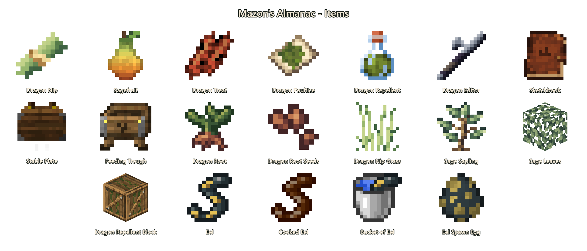
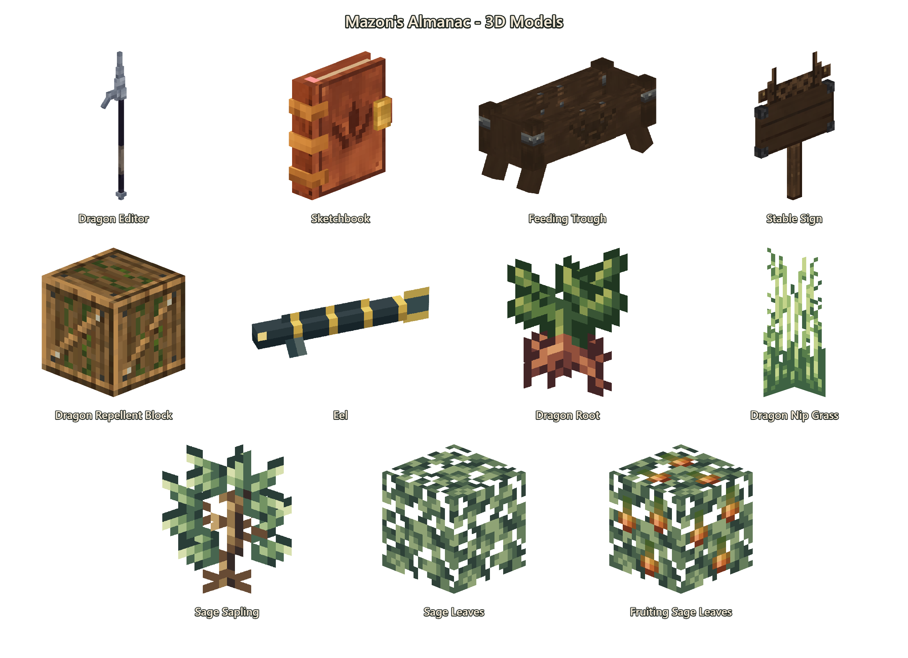
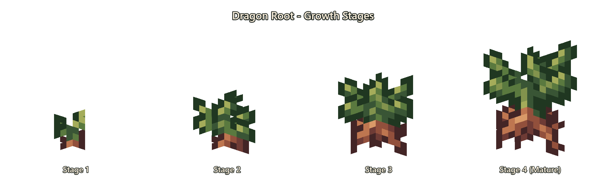
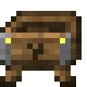
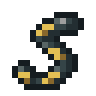
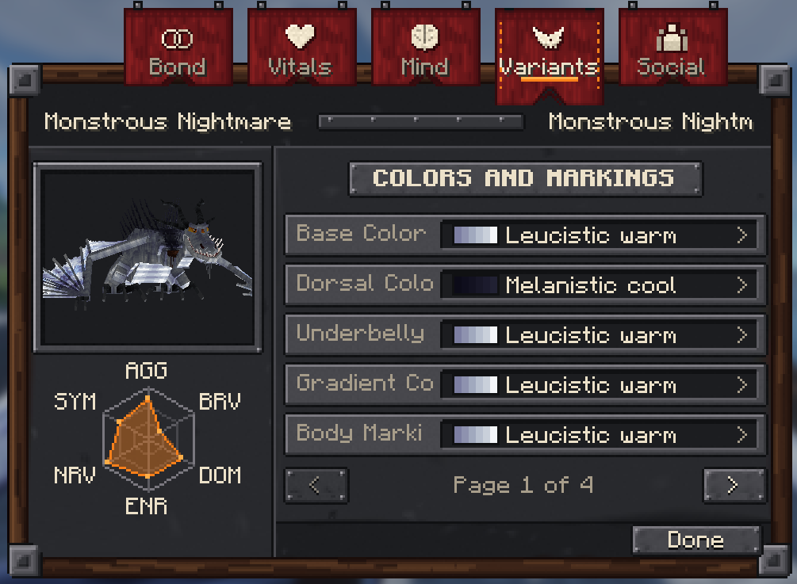

<p align="center">
  
</p>

<p align="center"><b>Raise your dragons like a real Viking: earn their trust, heal their wounds, and shape them your way.</b></p>

<p align="center">
  
  
  
  
</p>

Mazon's Almanac is an addon for [Book of Dragons](https://www.curseforge.com/minecraft/mc-mods/book-of-dragons). It adds the gear a dragon rider would actually carry: ways to win over wild dragons, treat injured ones, run a stable, and tweak every dragon to your liking.

## Quick start

1. Install NeoForge 21.1 for Minecraft 1.21.1 and Java 21.
2. Drop Book of Dragons, Fauna Engine, and this mod into your `mods` folder.
3. Start the game and look for the **Mazon's Almanac** tab in the creative inventory.

## What's in the Almanac







| | Item | What it does |
|---|---|---|
|  | **Dragon Nip** | Calms a wild dragon for five minutes so it's easier to tame. Grow more with Dragon Nip Grass. |
|  | **Sagefruit** | Makes a dragon befriend the dragons within 32 blocks that share its owner, or the other wild ones if it is wild. Grows on sage trees. |
|  | **Dragon Treat** | Builds loyalty with a dragon you've already tamed. |
|  | **Dragon Poultice** | Shortens an injured dragon's recovery time. |
|  | **Feeding Trough** | Hungry dragons nearby walk over and eat on their own. |
|  | **Stable Plate and Sign** | Link a plate to a Dragon Roost and name your stable. Dragons that live at the roost keep their stay order. |
|  | **Dragon Repellent** | Drink it for 8 minutes of Dragon Scent and wild dragons keep their distance. Also a placeable block. |
|  | **Eel** | A new catch when you fish in rivers and swamps. Wild dragons are scared of eels. Tamed ones are only disgusted by the item. |
|  | **Cooked Eel** | Cook an Eel in a furnace, smoker, or campfire. Restores as much hunger as cooked cod. |
|  | **Dragon Root Seeds** | Plant them in dirt or farmland and grow your own Dragon Root. |
|  | **Dragon Editor** | Creative only. Opens the editor below. |
|  | **Sketchbook** | Edit the colors and markings of a dragon you've tamed. The more it trusts you, the more looks it offers. |

Dragon Root is a plant that grows in four stages. Once it is fully grown it drives off wild dragons within 6 blocks.

<details>
<summary><b>How to get everything</b></summary>

### Crafting

| Item | Recipe |
|---|---|
| Dragon Treat (makes 2) | Cooked cod or cooked salmon, wheat, honey bottle (shapeless) |
| Dragon Poultice | Paper, moss block, honey bottle (shapeless) |
| Feeding Trough | Wooden slabs across the top and middle, sticks for the legs (`S S` / `SSS` / `L L`) |
| Stable Plate | Three iron ingots on top, then iron, leather, iron below |
| Dragon Root Seeds (makes 2) | One Dragon Root |
| Dragon Repellent | Eel, Dragon Root, glass bottle (shapeless) |
| Dragon Repellent Block | Two Dragon Repellent and two moss blocks (shapeless) |
| Dragon Editor | Creative inventory only |
| Sketchbook | Book, Ink Sac, Feather, and any dragon scale (shapeless) |
| Cooked Eel | Cook an Eel in a furnace, smoker, or campfire |

### Finding and gathering

| What | Where | How to get it |
|---|---|---|
| Dragon Nip | Dragon Nip Grass in plains, sunflower plains, meadows, forests, taigas, and windswept hills and forests. About 1 in 40 chunks has a patch. | Break the grass with any tool, or your bare hand, for 1 to 2 Dragon Nip. Shears give you the grass itself to replant. |
| Dragon Root | Swamps, mangrove swamps, dark forests, and old growth pine and spruce taigas. About 1 in 40 chunks has a small patch. | Break a fully grown one with anything for Dragon Root. A young one drops seeds. |
| Dragon Root Seeds | Young Dragon Root, or craft them from a Dragon Root. | Plant them on dirt or farmland. |
| Sage trees | Forests, flower forests, birch forests, old growth birch forests, and dark forests. Uncommon: about 1 in 40 chunks. | Break the leaves for Sagefruit and saplings. A hoe is the fastest tool. |
| Sagefruit | Fruiting sage leaves. | Break them without shears or Silk Touch. Those give you the leaf block instead. |
| Sage Sapling | Sage leaves. | A 5% drop per leaf, up to 10% with Fortune III. |
| Eel | Rivers, swamps, and mangrove swamps. | About 1 in 8 fish you catch there is an eel. Wild eels also spawn in those biomes, but rarely. Cook one in a furnace, smoker, or campfire for Cooked Eel, which restores as much as cooked cod. |

### Setting things up

- **Feeding Trough:** place it and dragons within 16 blocks come to eat. You can change the range in the config.
- **Stable Plate:** right-click a Dragon Roost with it to link them, then place it like a sign within 24 blocks of the roost. Dragons assigned to that roost keep their stay order when they are told to stay, and still rest and eat when they need to. You can change the range in the config.
- **Status:** sneak and right-click a Feeding Trough or a Stable Sign with an empty hand to see who is in reach, who is hungry, how full the trough is, and how the stable is holding its dragons. A normal right-click still opens the chest or the name box.
- **Dragon Treat and Dragon Poultice:** use them on your own tamed dragon. The poultice takes 60 seconds to work and then cuts an hour off the injury.
- **Dragon Root Seeds:** plant them on dirt, grass, or farmland in light level 9 or more. The plant grows through four stages and only the last one repels dragons. It grows about two and a half times faster on farmland than on plain dirt, and Bone Meal moves it up a stage.
- **Chest feeding:** a tamed dragon with a chest starts eating from it when its food drops to 70 out of 100, and keeps eating until it is full or the chest has nothing it will eat. You can change the start level in the config.
- **Eels and dragons:** wild dragons run from live eels, eel items and buckets of eel. Tamed dragons sniff and hiss at eel items but never run, so they keep following your orders. Every dragon refuses an eel if you offer it.
- **Dragon Nip and Sagefruit:** feed them to a wild dragon or one of your own. Nip calms it for five minutes. Sagefruit makes it befriend the dragons within 32 blocks that share its owner (a wild one befriends other wild ones), so your dragons never side with a wild dragon against you.

</details>

## Sketchbook

Right-click your own tamed dragon with the sketchbook. Opening it consumes one book in survival. You can make as many color and marking changes as you like during that session, and the more your dragon trusts you, the more of its colors and markings it offers. Common ones are always there; uncommon, rare and very rare ones unlock at bond 25, 50 and 90 (out of 100, set in the config). Locked options show the bond they need. Click a row to open the scrollable palette and zoom the live dragon toward the area you're editing. Drag the dragon to turn it, or scroll over it to zoom.

The page also shows the dragon's bond and what it needs for the next unlock, for example "Bond 42 / 50 for rare". **Undo** puts the dragon back to how it looked when you opened the book. **Save** gives you a Sketchbook Page with the dragon's current look, and **Paste** applies a page you're carrying to a dragon of the same kind. Looks the dragon hasn't earned the bond for are skipped, and the page isn't used up.

Use the page corners, Left and Right, or scroll over the right-hand page to turn pages. Set `pageFlip` in `bodaddon-client.toml` to `MESH` (default), `SIMPLE`, or `OFF`.

## Dragon Editor

Right-click any dragon with the Dragon Editor to open a work board with a live 3D preview. It has five tabs: **Bond** (loyalty from Wild to Devoted, or instant taming), **Vitals**, **Mind**, **Social** (make every dragon within 32 blocks get along), and **Variants**.

<table>
  <tr>
    <td></td>
    <td></td>
  </tr>
  <tr>
    <td align="center">Health, injuries, and breeding timer</td>
    <td align="center">Personality sliders with a live trait chart</td>
  </tr>
</table>

<p align="center">
  <br>
  <sub>Colors and markings</sub>
</p>

## Spatial GUI support

If you also have [Spatial GUI](https://www.curseforge.com/minecraft/mc-mods/spatial-gui) 1.x installed, the Almanac fixes its mouse picking while you ride a flying dragon. Spatial GUI normally builds its picking ray from camera yaw and pitch, which doesn't match the dragon flight camera, so menu clicks land in the wrong place. The Almanac uses the exact matrices Spatial GUI rendered the menu with instead. It only applies in flight with a Spatial GUI menu open, and it does nothing if Spatial GUI isn't installed. It's client-side only.

## Requirements

| Requirement | Version |
|---|---|
| Minecraft | 1.21.1 |
| Loader | NeoForge 21.1 or newer |
| Java | 21 |
| Book of Dragons | 1.4.2 or newer |
| Fauna Engine | 1.3 or newer (below 2.0) |
| Spatial GUI (optional) | 1.x |

<details>
<summary>Config options</summary>

You can change how far feeding troughs and stable plates reach, the food level at which a dragon starts eating from its chest, and the bond the Sketchbook asks for each rarity. Every species also has editable letter grades for its stats.

</details>

<details>
<summary>Building from source</summary>

The build compiles against the Book of Dragons and Fauna Engine jars, which aren't included here. Put `bookofdragons-1.4.2-1.21.1.jar` and `faunaengine-1.3-1.21.1-neoforge.jar` in a `libs/` folder in the project root. Add `spatial-gui-1.12.0-hotfix-1.21.1-neoforge.jar` there too, since the Spatial GUI fix compiles against it. Then run:

```bash
./gradlew build
```

</details>

## License

Released under the [MIT license](LICENSE).

This is a fan project. It is not affiliated with or endorsed by DreamWorks, Mojang, or the authors of Book of Dragons.
